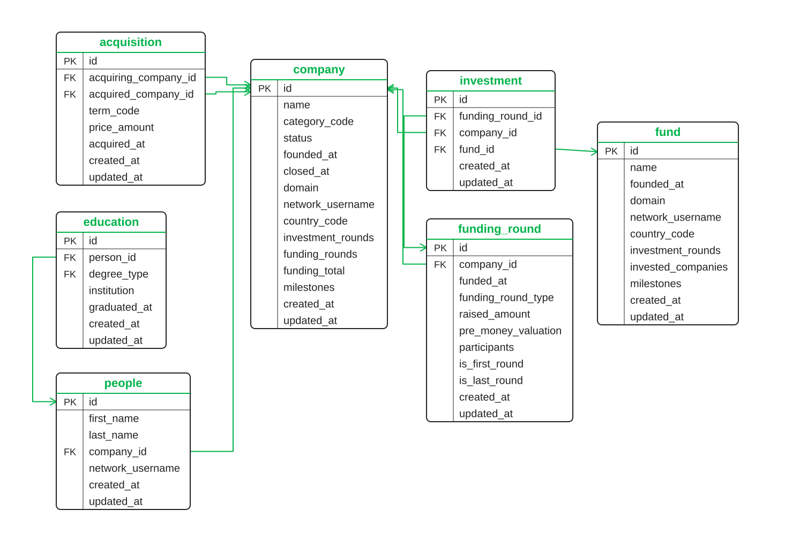

# Структура базы данных

База содержит сведения о стартапах, сотрудниках, венчурных фондах, инвестиционных раундах, инвестициях и сделках по приобретению компаний.

## ER-диаграмма

На схеме показаны семь таблиц и связи между ними: `company`, `people`, `education`, `fund`, `funding_round`, `investment` и `acquisition`.

## Таблицы и поля

### `company` — компании-стартапы

| Поле | Назначение |
|---|---|
| `id` | Первичный ключ, идентификатор компании |
| `name` | Название компании |
| `category_code` | Категория деятельности, например `news`, `social` |
| `status` | Статус: `acquired`, `operating`, `ipo`, `closed` |
| `founded_at` | Дата основания |
| `closed_at` | Дата закрытия, если компания прекратила существование |
| `domain` | Домен сайта |
| `network_username` | Аккаунт в корпоративной сети |
| `country_code` | Код страны регистрации |
| `investment_rounds` | Число раундов, в которых компания участвовала как инвестор |
| `funding_rounds` | Число раундов, в которых компания привлекала инвестиции |
| `funding_total` | Общая сумма привлечённых инвестиций, USD |
| `milestones` | Количество важных этапов |
| `created_at`, `updated_at` | Даты создания и обновления записи |

### `people` — сотрудники компаний

| Поле | Назначение |
|---|---|
| `id` | Первичный ключ, идентификатор сотрудника |
| `first_name`, `last_name` | Имя и фамилия |
| `company_id` | Внешний ключ на `company.id` |
| `network_username` | Аккаунт в корпоративной сети |
| `created_at`, `updated_at` | Даты создания и обновления записи |

### `education` — сведения об образовании сотрудников

| Поле | Назначение |
|---|---|
| `id` | Первичный ключ |
| `person_id` | Внешний ключ на `people.id` |
| `degree_type` | Тип степени, например `BA`, `MS` |
| `instituition` | Название учебного заведения — так поле написано в текстовом описании |
| `graduated_at` | Дата выпуска |
| `created_at`, `updated_at` | Даты создания и обновления записи |

### `fund` — венчурные фонды

| Поле | Назначение |
|---|---|
| `id` | Первичный ключ, идентификатор фонда |
| `name` | Название фонда |
| `founded_at` | Дата основания |
| `domain` | Домен сайта |
| `network_username` | Аккаунт в корпоративной сети |
| `country_code` | Код страны фонда |
| `investment_rounds` | Число инвестиционных раундов фонда |
| `invested_companies` | Число компаний, в которые инвестировал фонд |
| `milestones` | Количество важных этапов |
| `created_at`, `updated_at` | Даты создания и обновления записи |

### `funding_round` — раунды финансирования

| Поле | Назначение |
|---|---|
| `id` | Первичный ключ, идентификатор раунда |
| `company_id` | Внешний ключ на `company.id` |
| `funded_at` | Дата раунда |
| `funding_round_type` | Тип раунда, например `venture`, `angel`, `series_a` |
| `raised_amount` | Сумма привлечённых средств в раунде, USD |
| `pre_money_valuation` | Оценка компании до инвестиций, USD |
| `participants` | Количество участников раунда |
| `is_first_round`, `is_last_round` | Признаки первого и последнего раунда |
| `created_at`, `updated_at` | Даты создания и обновления записи |

### `investment` — инвестиции фондов в стартапы

| Поле | Назначение |
|---|---|
| `id` | Первичный ключ, идентификатор инвестиции |
| `funding_round_id` | Внешний ключ на `funding_round.id` |
| `company_id` | Внешний ключ на `company.id` |
| `fund_id` | Внешний ключ на `fund.id` |
| `created_at`, `updated_at` | Даты создания и обновления записи |

### `acquisition` — сделки по приобретению компаний

| Поле | Назначение |
|---|---|
| `id` | Первичный ключ, идентификатор сделки |
| `acquiring_company_id` | Внешний ключ на `company.id`, компания-покупатель |
| `acquired_company_id` | Внешний ключ на `company.id`, приобретённая компания |
| `term_code` | Условия оплаты: `cash`, `stock`, `cash_and_stock` |
| `price_amount` | Цена сделки, USD |
| `acquired_at` | Дата сделки |
| `created_at`, `updated_at` | Даты создания и обновления записи |

## Основные связи

- `people.company_id` → `company.id`: сотрудники относятся к компаниям.
- `education.person_id` → `people.id`: образование относится к сотрудникам.
- `funding_round.company_id` → `company.id`: раунды финансирования принадлежат компаниям.
- `investment.funding_round_id` → `funding_round.id`: инвестиции связаны с раундами.
- `investment.company_id` → `company.id`: инвестиция относится к стартапу.
- `investment.fund_id` → `fund.id`: инвестиция поступает от фонда.
- `acquisition.acquiring_company_id` и `acquisition.acquired_company_id` → `company.id`: обе стороны сделки ссылаются на компании.

## Замечания к исходной схеме

1. В текстовом описании таблицы `education` поле учебного заведения названо `instituition`, и исходный SQL-запрос № 6 использует то же написание. На ER-диаграмме название визуально выглядит как `institution`. В проекте сохранено исходное имя из текстового описания и SQL; перед запуском запроса его необходимо сверить с фактической схемой БД.
2. На ER-диаграмме поле `education.degree_type` также помечено как внешний ключ, однако текстовое описание приводит только значения `BA` и `MS` и не указывает таблицу, на которую ссылается поле. Целевая таблица по предоставленным материалам не определяется.
3. В исходном текстовом описании поля `acquisition` перечислены в самом начале файла без отдельного заголовка таблицы. Таблица идентифицирована по полям, связям на ER-диаграмме и использованию в SQL-заданиях.
